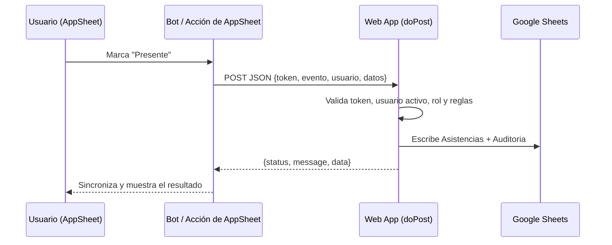

# 📱 Especificación de Configuración de AppSheet: `Asistencia Colegio`

Este documento describe cómo construir el frontend móvil/web en **AppSheet** conectado a la planilla de Google Sheets y al **webhook** de Google Apps Script (`src/Webhook.gs`).

---

## 0. 🧭 Principio de integración

AppSheet **lee** las hojas directamente, pero las **escrituras de negocio** (asistencia, justificativos, cambio de jornada) deben pasar por el webhook. Así se aplican siempre las reglas del sistema:

- solo lunes a viernes,
- curso activo con jornada válida,
- hora dentro del horario de la jornada,
- permisos por rol y por curso asignado,
- auditoría de cada acción.

> Si AppSheet escribe directamente en `Asistencias` o `Justificativos`, **esas reglas no se aplican**. Por eso las tablas de negocio se conectan como **Read Only** y las acciones llaman al webhook.



---

## 1. ⚙️ Conexión de Fuente de Datos (Data Source)

- **Provider**: Google Sheets (`Google Drive`)
- **Libro de Cálculo**: `Asistencia Colegio`
- **Pestañas conectadas**:

| Pestaña | Permisos en AppSheet | Comentario |
| :--- | :--- | :--- |
| `Usuarios` | Read Only | Para resolver rol del usuario. |
| `Niveles` | Read Only | Cursos y jornada vigente. |
| `Estudiantes` | Read Only | |
| `Asignaciones` | Read Only | Filtra qué cursos ve cada docente. |
| `Asistencias` | Read Only | Se escribe vía webhook. |
| `Justificativos` | Read Only | Se escribe vía webhook. |
| `Resumenes` | Read Only | Consulta de resúmenes semanales. |
| `Auditoria` | Read Only | Solo Administrador. |

> `App_Transacciones` y `App_Solicitudes` existen en la planilla (ver `Config.gs`) pero **ningún código las procesa todavía**. No las use hasta que se implemente ese puente.

---

## 2. 🗃️ Definición de Tablas y Esquemas de Columnas

### 2.1 Tabla `Niveles`
- `id_nivel`: Text (Key)
- `nombre_nivel`: Text (Label)
- `grado`: Number (1, 2, 3)
- `seccion`: Text
- `jornada`: Enum (`Mañana`, `Tarde`, `Noche`)
- `estado`: Enum (`Activo`, `Inactivo`)
- `fecha_creacion`, `fecha_modificacion`: DateTime

### 2.2 Tabla `Estudiantes`
- `id_estudiante`: Text (Key, Hidden)
- `rut_dni`: Text (Label)
- `nombres`: Text
- `apellidos`: Text
- `id_nivel`: Ref -> Tabla `Niveles`
- `email_apoderado`: Email

### 2.3 Tabla `Asistencias` (Read Only)
- `id_asistencia`: Text (Key)
- `id_estudiante`: Ref -> Tabla `Estudiantes`
- `fecha`: Date
- `estado`: Enum (`Presente`, `Ausente`, `Atrasado`, `Justificado`)
- `observacion`: LongText
- `registrado_por`: Email
- `timestamp`: DateTime
- `jornada`: Enum (`Mañana`, `Tarde`, `Noche`) — jornada vigente al registrar

### 2.4 Tabla `Justificativos` (Read Only)
- `id_justificativo`: Text (Key)
- `id_estudiante`: Ref -> Tabla `Estudiantes`
- `fecha_inicio`, `fecha_fin`: Date
- `tipo`: Enum (`Médico`, `Personal`, `Gendarmería`, `Otros`)
- `motivo`: LongText
- `url_archivo_drive`: Text / File (carpeta `Justificativos_Escolares/{Año}`)
- `estado_aprobacion`: Enum (`Pendiente`, `Aprobado`, `Rechazado`)
- `registrado_por`: Email
- `timestamp`: DateTime

---

## 3. ✂️ Slices (Filtros de Datos)

1. **`Justificativos_Pendientes`**
   - Filtro: `[estado_aprobacion] = "Pendiente"`
   - Propósito: bandeja de revisión para Inspectores y Directivos.

2. **`Asistencias_Hoy`**
   - Filtro: `[fecha] = TODAY()`
   - Propósito: asistencia del día en curso.

3. **`Alumnos_En_Riesgo`**
   - Filtro: `COUNT(FILTER("Asistencias", AND([id_estudiante] = [_THISROW].[id_estudiante], [estado] = "Ausente"))) > 3`
   - Propósito: alerta temprana para Inspectores.
   - *Referencia:* el umbral oficial del sistema es **asistencia < 85%** (`CONFIG.REPORTS.CRITICAL_THRESHOLD_PERCENT`); este slice es solo una aproximación visual.

4. **`Cursos_Activos`**
   - Filtro: `OR(ISBLANK([estado]), [estado] = "Activo")`
   - Propósito: ofrecer solo cursos que pueden recibir asistencia.

---

## 4. 🖼️ Vistas de Usuario (UX Views)

### 4.1 Vista "Lista de Alumnos" (Deck View con Acciones Rápidas)
- **Tabla**: `Estudiantes` (agrupada por `id_nivel`; el docente ve solo sus cursos, ver §7).
- **Header**: `[nombres] & " " & [apellidos]`
- **Subheader**: `[rut_dni]`
- **Acciones en la ficha**: 🟢 Presente, 🔴 Ausente, 🟡 Atrasado (cada una llama al webhook, §6.1).
- Mostrar la jornada del curso: `[id_nivel].[jornada]`.

### 4.2 Vista "Ingreso de Justificativos"
- **Tipo**: Form View sobre una vista auxiliar o formulario de AppSheet.
- **Campos**: Alumno, Fecha inicio, Fecha fin, Tipo, Motivo, Captura de cámara / documento.
- Al guardar, un bot llama al webhook `JUSTIFICATIVO_SOLICITAR` (§6.3). El justificativo **siempre** se crea en estado `Pendiente`.

### 4.3 Vista "Bandeja de Aprobación"
- **Tipo**: Table View sobre el slice `Justificativos_Pendientes`.
- **Acciones**: ✅ Aprobar y ❌ Rechazar, que llaman a `JUSTIFICATIVO_ACTUALIZAR` (§6.4).
- Al aprobar, el sistema marca como `Justificado` los días de lunes a viernes del rango.

### 4.4 Vista "Cambiar jornada" (solo Administrador)
- Formulario con curso y nueva jornada → `CURSO_CAMBIAR_JORNADA` (§6.2).

---

## 5. ⚡ Despliegue del Webhook (Web App)

1. En el editor de Apps Script: **Implementar > Nueva implementación > Aplicación web**.
2. **Ejecutar como**: *Yo* (la cuenta propietaria).
3. **Quién tiene acceso**: *Cualquier usuario* (la autenticación real la hace el token, ver §5.2).
4. Copie la **URL de la aplicación web** (termina en `/exec`).
5. Cada vez que cambie el código, cree una **nueva versión** de la implementación.

### 5.1 Generar el token
1. Ejecute `generateWebhookToken()` desde el editor.
2. Copie el token del **registro de ejecución** (se muestra una sola vez). Se guarda en *Propiedades del script* como `WEBHOOK_TOKEN`.
3. Para rotarlo, vuelva a ejecutar la función y actualice AppSheet.

### 5.2 Seguridad del webhook
- **Falla cerrado**: si `WEBHOOK_TOKEN` no existe, se rechaza toda solicitud.
- Apps Script no permite leer cabeceras HTTP: el token viaja **en el cuerpo JSON** (`token`) o en `?token=`. Prefiera el cuerpo para que no quede en logs de URL.
- El campo `usuario` debe ser un email **registrado y Activo** en `Usuarios`; su rol define qué eventos puede ejecutar.
- Los errores internos devuelven un mensaje genérico; el detalle va a `Auditoria`.
- Los rechazos de autenticación se auditan con un límite de 1 por minuto.
- Límites: cuerpo ≤ 100 000 caracteres, observación ≤ 500, motivo/comentario ≤ 1000.
- Limite quién puede editar el bot de AppSheet: el token queda visible para los editores de la app.

---

## 6. 🔌 Contrato del Webhook

**Método:** `POST` a la URL `/exec`, `Content-Type: application/json`.

```json
{
  "token":   "<WEBHOOK_TOKEN>",
  "evento":  "ASISTENCIA_REGISTRAR",
  "usuario": "<<USEREMAIL()>>",
  "datos":   { }
}
```

**Formatos:** fechas `YYYY-MM-DD`, horas `HH:mm` (24 h).

**Respuesta (siempre JSON):**
```json
{ "status": "success", "message": "Asistencia registrada.", "data": { } }
```
```json
{ "status": "error", "message": "…", "data": { "codigo": "OUT_OF_SCHEDULE" } }
```

### 6.1 `ASISTENCIA_REGISTRAR` / `ASISTENCIA_ACTUALIZAR`
Roles: Administrador, Docente, Inspector. Un **Docente** solo puede registrar alumnos de cursos que tenga en `Asignaciones`.

| Campo | Obligatorio | Descripción |
| :--- | :---: | :--- |
| `id_estudiante` | ✅ | ID del alumno. |
| `fecha` | ✅ | Solo lunes a viernes. |
| `estado` | ✅ | `Presente`, `Ausente`, `Atrasado`, `Justificado`. |
| `observacion` | | Hasta 500 caracteres. |
| `hora` | | `HH:mm`; debe caer dentro de la jornada del curso. |
| `jornada` | | Si se envía, debe coincidir con la del curso. |

- `ASISTENCIA_REGISTRAR` falla con `DUPLICATE` si ya existe registro para ese alumno y fecha.
- `ASISTENCIA_ACTUALIZAR` falla con `NOT_FOUND` si no existe.

```json
{
  "token": "<WEBHOOK_TOKEN>",
  "evento": "ASISTENCIA_REGISTRAR",
  "usuario": "<<USEREMAIL()>>",
  "datos": {
    "id_estudiante": "<<[id_estudiante]>>",
    "fecha": "<<TEXT(TODAY(), \"yyyy-mm-dd\")>>",
    "estado": "Presente",
    "hora": "<<TEXT(TIMENOW(), \"hh:mm\")>>"
  }
}
```

> En AppSheet, `TEXT(..., "hh:mm")` devuelve formato 24 h solo si el formato del *locale* lo permite; si la hora llega fuera de horario, el webhook responde `OUT_OF_SCHEDULE`. Si no necesita validar la hora, omita `hora`.

### 6.2 `CURSO_CAMBIAR_JORNADA`
Rol: **Administrador**. Solo afecta tomas de asistencia futuras.

| Campo | Obligatorio |
| :--- | :---: |
| `id_nivel` (ID existente o sugerido, ej. `CUR-1A` o `N-101`) | ✅ |
| `jornada` (`Mañana`, `Tarde`, `Noche`) | ✅ |

### 6.3 `JUSTIFICATIVO_SOLICITAR`
Roles: Administrador, Inspector. Siempre se crea en estado **Pendiente**.

| Campo | Obligatorio | Descripción |
| :--- | :---: | :--- |
| `id_estudiante` | ✅ | |
| `fecha_inicio` | ✅ | |
| `fecha_fin` | ✅ | No puede ser anterior a `fecha_inicio`. |
| `tipo` | ✅ | `Médico`, `Personal`, `Gendarmería`, `Otros`. |
| `motivo` | | Hasta 1000 caracteres. |
| `url_archivo_drive` | | URL del adjunto (hasta 500 caracteres). |

### 6.4 `JUSTIFICATIVO_ACTUALIZAR`
Roles: Administrador, Inspector, Directivo.

| Campo | Obligatorio | Descripción |
| :--- | :---: | :--- |
| `id_justificativo` | ✅ | |
| `estado_aprobacion` | ✅ | `Aprobado`, `Rechazado` (o `Pendiente`). |
| `comentario` | | Hasta 1000 caracteres. |

Al pasar a `Aprobado`, los días lunes–viernes del rango se marcan `Justificado` en `Asistencias`.

### 6.5 Códigos de error frecuentes

| Código | Significado |
| :--- | :--- |
| `UNAUTHORIZED` | Token ausente o incorrecto. |
| `NOT_CONFIGURED` | `WEBHOOK_TOKEN` no está configurado (mensaje genérico "Servicio no disponible"). |
| `BAD_REQUEST` | JSON inválido, `usuario` no es email, falta un campo, evento no soportado. |
| `FORBIDDEN` | Usuario no registrado/inactivo, rol sin permiso o docente sin el curso asignado. |
| `INVALID_DATE` / `INVALID_DAY` | Fecha inexistente / fin de semana. |
| `INVALID_TIME` / `OUT_OF_SCHEDULE` | Hora mal formada / fuera del horario de la jornada. |
| `INVALID_STATUS` | Estado de asistencia no válido. |
| `INVALID_JORNADA` / `JORNADA_MISMATCH` | Jornada inválida / distinta a la del curso. |
| `COURSE_INACTIVE` | El curso está inactivo. |
| `NOT_FOUND` | Alumno, curso o registro inexistente. |
| `DUPLICATE` | Ya existe el registro (asistencia del día). |
| `ERROR_INTERNO` | Fallo no esperado; revisar `Auditoria` (acción `WEBHOOK_ERROR`). |

### 6.6 Configuración del Bot en AppSheet
- **Event**: la acción o el cambio de datos que corresponda.
- **Process > Task**: *Call a webhook*.
  - **Url**: URL `/exec` de la Web App.
  - **HTTP Verb**: `POST`.
  - **HTTP Content Type**: `JSON`.
  - **Body**: JSON del evento correspondiente.
  - **Return value**: `Sí`, para poder mostrar `message` al usuario.
- Dado que el webhook devuelve `200` incluso para errores de negocio, evalúe `status` en la respuesta.

---

## 7. 🔒 Seguridad y Autenticación en AppSheet

- **Require User Sign-In**: Yes
- **Authentication Provider**: Google (restringido al dominio institucional)
- **Dominio permitido**: dominio institucional de Google Workspace (el mismo de los correos en `Usuarios`)
- **Security Filters**:
  - `Docentes`: solo ven alumnos de cursos que figuran en `Asignaciones`.
  - `Inspectores / Directivos / Administradores`: según su rol.
- El rol efectivo lo valida **siempre** el webhook contra la hoja `Usuarios`; los filtros de AppSheet son solo de comodidad de uso.

---

## 8. 🔄 Sincronización (Offline-First)

- **Offline Mode**: habilitado (*Store data for offline use*).
- **Sync on Start**: habilitado.
- **Automatic Background Sync**: habilitado.
- **Delayed Syncing**: habilitado.

> **Importante:** una llamada a webhook **requiere conexión**. Sin red, la acción queda encolada por AppSheet y se ejecuta al sincronizar; en ese caso la `hora` enviada puede quedar fuera de la ventana de la jornada. Si el uso offline es frecuente, omita `hora` o implemente el puente `App_Transacciones`.
