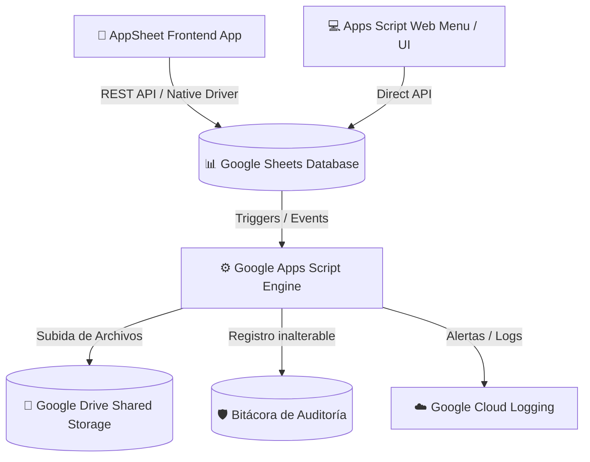

# 🏗️ Arquitectura del Sistema - Asistencia Colegio

## 1. Resumen Ejecutivo
El sistema **Asistencia Colegio** es una solución cloud-native serverless construida sobre la suite de **Google Workspace** y **Google Cloud**. Proporciona registro de asistencia en tiempo real, gestión de justificativos con adjuntos y auditoría inmutable.

---

## 2. Diagrama de Arquitectura de Alto Nivel

---

## 3. Componentes Principales

### 3.1 Base de Datos Relacional Abstraída (Google Sheets)
- Actúa como la fuente de verdad persistente (*Single Source of Truth*).
- Las pestañas imitan tablas de base de datos relacional con claves primarias UUID.

### 3.2 Lógica de Negocio (Google Apps Script - V8)
- Implementada en archivos `.gs` organizados por responsabilidades modulares:
  - `Config.gs`: Definiciones globales.
  - `AttendanceService.gs`: Validaciones y reglas de asistencia.
  - `JustificationService.gs`: Integración con Google Drive para documentos.
  - `AuditService.gs`: Garantiza trazabilidad e inmutabilidad de acciones.

### 3.3 Frontend de Captura Móvil (AppSheet)
- Interfaz nativa para teléfonos y tablets usada por profesores e inspectores.
- Sincronización offline-first con soporte para captura de firmas y documentos.

### 3.4 Almacenamiento Seguro de Archivos (Google Drive)
- Carpeta compartida institucional (*Shared Drive*) estructurada por Año y Tipo de justificativo.
