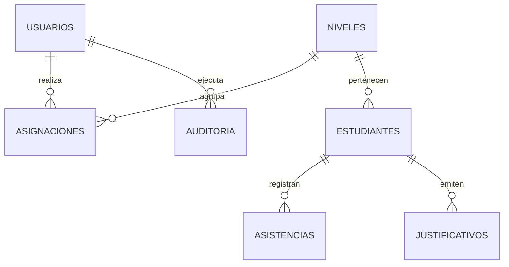

# 🗄️ Modelo de Datos - Asistencia Colegio

## 1. Esquema Entidad-Relación (ER)

---

## 2. Definición de Tablas (Google Sheets)

### 2.1 Tabla `Usuarios`
| Columna | Tipo | Clave | Descripción |
| :--- | :--- | :--- | :--- |
| `id_usuario` | String (UUID) | PK | Identificador único del usuario |
| `email` | String | Unique | Correo institucional Google |
| `nombre_completo` | String | - | Nombre y apellido del funcionario |
| `rol` | Enum | - | `Administrador`, `Docente`, `Directivo`, `Inspector` |
| `estado` | String | - | `Activo`, `Inactivo` |

### 2.2 Tabla `Niveles`
| Columna | Tipo | Clave | Descripción |
| :--- | :--- | :--- | :--- |
| `id_nivel` | String (UUID) | PK | ID único del curso/nivel |
| `nombre_nivel` | String | - | Ej: "1° Medio A", "8° Básico B" |
| `grado` | Number | - | Nivel numérico (1 a 12) |
| `seccion` | String | - | Letra de sección ("A", "B") |

### 2.3 Tabla `Estudiantes`
| Columna | Tipo | Clave | Descripción |
| :--- | :--- | :--- | :--- |
| `id_estudiante` | String (UUID) | PK | ID único del estudiante |
| `rut_dni` | String | Unique | Documento de identidad |
| `nombres` | String | - | Nombres del alumno |
| `apellidos` | String | - | Apellidos del alumno |
| `id_nivel` | String (UUID) | FK | Referencia a `Niveles.id_nivel` |
| `email_apoderado` | String | - | Correo de contacto apoderado |

### 2.4 Tabla `Asistencias`
| Columna | Tipo | Clave | Descripción |
| :--- | :--- | :--- | :--- |
| `id_asistencia` | String (UUID) | PK | ID de registro |
| `id_estudiante` | String (UUID) | FK | Referencia a `Estudiantes.id_estudiante` |
| `fecha` | Date (YYYY-MM-DD) | - | Fecha de la asistencia |
| `estado` | Enum | - | `Presente`, `Ausente`, `Atrasado`, `Justificado` |
| `observacion` | String | - | Nota opcional del profesor |
| `registrado_por` | String | FK | Email del usuario emisor |
| `timestamp` | DateTime | - | Fecha y hora exacta de registro |

### 2.5 Tabla `Justificativos`
| Columna | Tipo | Clave | Descripción |
| :--- | :--- | :--- | :--- |
| `id_justificativo` | String (UUID) | PK | ID del justificativo |
| `id_estudiante` | String (UUID) | FK | Referencia al alumno |
| `fecha_inicio` | Date | - | Inicio del periodo de inasistencia |
| `fecha_fin` | Date | - | Término del periodo |
| `tipo` | Enum | - | `Médico`, `Personal`, `Gendarmería`, `Otros` |
| `motivo` | String | - | Descripción sintética |
| `url_archivo_drive` | String | - | Enlace directo al PDF/imagen en Drive |
| `estado_aprobacion` | Enum | - | `Pendiente`, `Aprobado`, `Rechazado` |
| `registrado_por` | String | - | Correo del funcionario receptivo |
| `timestamp` | DateTime | - | Registro temporal |

### 2.6 Tabla `Auditoria`
| Columna | Tipo | Clave | Descripción |
| :--- | :--- | :--- | :--- |
| `id_evento` | String (UUID) | PK | ID evento |
| `timestamp` | DateTime | - | Timestamp preciso |
| `usuario` | String | - | Email ejecutor |
| `accion` | String | - | Nombre de acción |
| `tabla_afectada` | String | - | Nombre de la hoja |
| `id_registro` | String | - | ID afectado |
| `detalle` | String | - | JSON o texto descriptivo |
